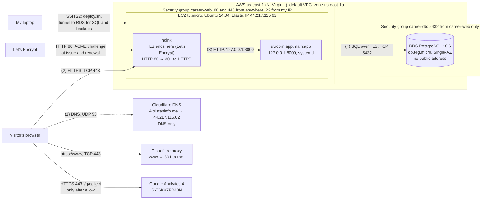
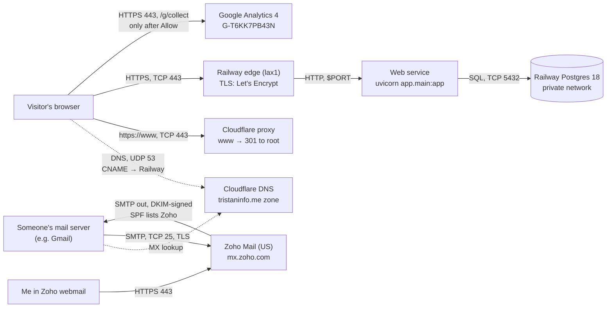
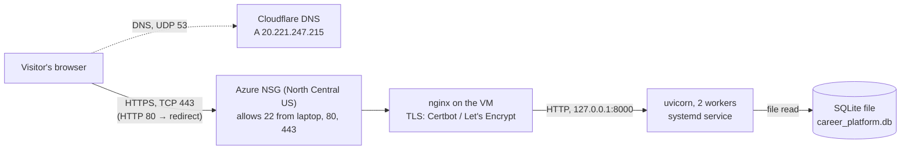

# Career Platform

A recruiter-focused personal career website built with FastAPI, using PostgreSQL in production (Amazon RDS, on AWS since 2026-11-08) and SQLite locally.

- **Live site:** <https://tristaninfo.me>. `www.tristaninfo.me` redirects there, see [`docs/evidence/https.md`](docs/evidence/https.md)
- **Repository:** <https://github.com/tscholzbrennan/career-platform>
- **Email:** `tristan@tristaninfo.me` (Zoho Mail)

## Design and plans

- Spec: [`docs/superpowers/specs/2026-09-15-career-platform-resume-site-design.md`](docs/superpowers/specs/2026-09-15-career-platform-resume-site-design.md)
- Plan: [Move to the Azure VM](docs/superpowers/plans/2026-09-24-azure-vm-migration.md) (2026-09-24)
- Plan: [Operate the VM](docs/superpowers/plans/2026-10-01-operate-the-vm.md) (systemd, nginx, HTTPS; 2026-10-01)
- Plan: [Move to Railway + PostgreSQL](docs/superpowers/plans/2026-10-08-railway-postgres-migration.md) (2026-10-08). There's no separate spec file for this move. The spec was the request in conversation, quoted at the top of the plan.
- Plan: [Move to AWS (EC2 + Single-AZ RDS)](docs/superpowers/plans/2026-11-03-aws-ec2-rds-migration.md) (2026-11-03). The spec was the request in conversation, quoted at the top of the plan. Every deviation from the plan, and the test and cutover results, are in [`migration-notes.md`](migration-notes.md).
- Project 1 submission index: [`docs/project-1-submission.md`](docs/project-1-submission.md)

Evidence:

- [Exercise 6: custom-domain email (Zoho) and analytics (GA4)](docs/evidence/ex06.md)
- [Zoho Mail header check (Test 02, delivered to Spam)](docs/evidence/zoho-header-check.md)
- [DNS records and their purposes](docs/evidence/dns-before-zoho.md)
- [How this site is secured](docs/how-this-site-is-secured.md): my Exercise 04 HTTPS explanation, written for the Azure VM
- [HTTPS certificate and `www`](docs/evidence/https.md)
- [A reviewed change through Railway](docs/evidence/reviewed-change.md)
- [Postgres password rotation (2026-10-25)](docs/evidence/postgres-credential-rotation.md)

## Local setup

1. Create a virtual environment.
2. Install dependencies:
   `pip install -r requirements.txt`
3. Start the app:
   `uvicorn app.main:app --reload`
4. Visit `http://localhost:8000`.

`career_platform.db` isn't in the repo. On first start the app creates it and fills it with placeholder seed data. To work with real content, copy it down from RDS through an SSH tunnel (see "Reaching the database" under Deploy): `python -m app.copy_database --source "postgresql://career_app:<password>@127.0.0.1:55432/career_platform?sslmode=require" --target sqlite:///career_platform.db`.

## Update steps

**Code or templates:**
1. Make the change on a branch and open a pull request into `main` (or commit to `main`).
2. Run `uv run python -m pytest -q`. Everything must pass.
3. Review the diff, then commit and merge.
4. `git push origin main`, then deploy it: `ssh -i ~/.ssh/career-platform-aws ubuntu@44.217.115.62 'cd career-platform && ./deploy/deploy.sh'`. Pushing alone deploys nothing (see Deploy).
5. Check the live site: the changed page, plus `curl -s https://tristaninfo.me/api/profile` showing `"source":"database"`.

**Content** (profile, experience, projects, skills): this lives in RDS PostgreSQL, not in the repo. There's no admin page, so a change is an SQL `UPDATE` or `INSERT` run through the SSH tunnel (see "Reaching the database" under Deploy), made after a `pg_dump` backup. Make the same change in `data/fallback-profile.json`, so the outage snapshot stays current, and commit that.

## Environment

Copy `.env.example` to `.env` and adjust values if needed.

`DATABASE_URL` selects the database. Leave it unset to use `career_platform.db`. In production (`APP_ENV=production`, set in the systemd unit, or on Railway) the app refuses to start without it, so a missing value can't quietly serve SQLite placeholder content.

Run the tests against Postgres with `TEST_DATABASE_URL=postgresql://localhost/career_platform_test pytest`. The tests drop every table, so only local databases are accepted.

## Architecture

### AWS (current, since 2026-11-08)



- **Web:** the browser looks up `tristaninfo.me` in Cloudflare, which answers with the EC2 Elastic IP directly (DNS only, no proxy). The request goes to nginx on the instance, where TLS ends, then to uvicorn on `127.0.0.1:8000`, then to RDS over TLS (`sslmode=verify-full` with the RDS CA bundle). If RDS is down, the profile is served from `data/fallback-profile.json` and project pages return `503` (see Fallback profile behavior).
- **Network:** the instance accepts 80 and 443 from anywhere and SSH only from my laptop's IP. RDS has no public address and accepts 5432 only from the instance's security group, so the database can't be reached from the internet. `aws.tristaninfo.me` points at the same Elastic IP, also DNS only (course instructions).
- **TLS:** one Let's Encrypt certificate covers `tristaninfo.me` and `aws.tristaninfo.me`. certbot proves control over HTTP on port 80 (webroot), and `certbot.timer` renews it, with a hook that reloads nginx.
- **Admin:** I deploy and reach the database over SSH from my laptop. SQL and `pg_dump` go through an SSH tunnel to RDS, because RDS isn't public.
- **Unchanged from Railway:** analytics goes straight from the browser to Google, and email goes through Zoho by the MX records in Cloudflare. Neither touches AWS. The email path is in the Railway diagram below.

Why the site runs like this, and the limits that shaped it (an instance-size policy, the Free plan): the AWS decision under Decisions, and [`migration-notes.md`](migration-notes.md).

### Railway (2026-10-08 to 2026-11-08)



- **Web:** the page request goes browser → Railway edge, where TLS ends → the app → Postgres. If Postgres is down, the profile is served from `data/fallback-profile.json` instead (see Fallback profile behavior).
- **Analytics:** goes straight from the visitor's browser to Google, never through Railway, and only after the visitor chooses Allow. Details: [`ex06.md` §5](docs/evidence/ex06.md).
- **Email:** never touches the web app. Other servers look up `tristaninfo.me`'s MX in Cloudflare and deliver to Zoho. Mail I send leaves from Zoho's servers, signed with DKIM, and receivers check it against the SPF and DMARC records. Details: [`ex06.md` §4](docs/evidence/ex06.md).

### Azure VM (2026-09-24 to 2026-10-08)



Email (Zoho, 2026-10-13) and analytics (GA4, 2026-10-15) were set up after the move to Railway, so they never ran alongside the VM. Their paths don't depend on the host anyway: they'd be the same with the VM. A version of these diagrams that starts at the home router is in [`docs/request-path-diagrams.md`](docs/request-path-diagrams.md).

### How the move preserved the data

1. **Content freeze:** no edits from the copy until DNS pointed at Railway.
2. **Source of truth:** the copy came from the VM's live database, not the repo copy. It was taken with `sqlite3 .backup`, which gives a consistent snapshot while the app has the file open, and a backup was kept on the VM.
3. **Copy:** `python -m app.copy_database` copied all 7 tables into an empty Railway Postgres. It refuses a non-empty target, checks the row counts after copying, and resets each ID sequence so new rows don't collide.
4. **Verification:** the copy was compared table by table against a fresh read of the live VM database: identical counts and values (114 values checked). A deliberately altered copy was flagged, so the check works.
5. **Cutover last:** the web service was deployed against that data before DNS moved. Those checks weren't written down at the time, and the post-cutover checks are in the plan. The VM kept serving until DNS moved, and is kept deallocated as the rollback.

Full record: [Railway plan, Task 3](docs/superpowers/plans/2026-10-08-railway-postgres-migration.md). What responsibilities moved is in the "Who manages what" table under Deploy.

The move from Railway to AWS followed the same pattern: a content freeze, a fresh `pg_dump` from Railway restored into an empty RDS database with `pg_restore`, and a table-by-table comparison of row counts and content checksums (7 tables, 18 rows, identical), repeated just before DNS moved. The app ran on AWS, at `aws.tristaninfo.me`, for testing before the main domain was switched. Details: [`migration-notes.md`](migration-notes.md).

## Deploy

Production runs on one EC2 instance (`t3.micro`, Ubuntu 24.04, Elastic IP `44.217.115.62`) with the app in `/home/ubuntu/career-platform`. The server's setup is in the repo under `deploy/`:

- `career-platform.service`: the systemd unit. One uvicorn process on `127.0.0.1:8000`, `APP_ENV=production`, `Restart=always` with no retry limit, so the app keeps retrying until RDS answers.
- `nginx-career-platform.conf`: HTTPS on 443 with the Let's Encrypt certificate. Port 80 serves only certbot's challenge and redirects everything else to HTTPS.
- `journald-retention.conf`: keeps logs 7 days, as the privacy page says. nginx's logs rotate daily and keep 7.
- `deploy.sh`: the deploy script, below.

The server's `.env` (mode 600, not in git) holds only `DATABASE_URL`. It includes `sslmode=verify-full` with the RDS CA bundle, plus `connect_timeout=5&tcp_user_timeout=5000` so a database outage fails fast instead of hanging.

**Deploy branch: `main`, manual deploy.** Pushing to `main` no longer deploys anything. A change goes: diff reviewed → `pytest` passes locally → pull request merged (or commit) → push to `main` → `./deploy/deploy.sh` on the server → check the live site. `deploy.sh` runs `git pull --ff-only`, installs `requirements.txt`, restarts the service, and exits with an error unless `/api/profile` reports `"source":"database"` within 30 seconds. The first deploys from `main` on AWS were `ee09b83` (PR #2) and `ea865d2` on 2026-11-08.

### Reaching the database

RDS has no public address, so SQL and backups go through an SSH tunnel from the laptop. The RDS endpoint is in the RDS console; the passwords are in `~/.career-platform-aws/secrets.env` on the laptop, never in the repo.

```
ssh -i ~/.ssh/career-platform-aws -N -L 55432:<rds-endpoint>:5432 ubuntu@44.217.115.62
```

Then use port `55432` on `127.0.0.1` with `sslmode=require`, as `career_app` (owns the `career_platform` database; the app uses it) or `career_admin` (the RDS admin login). RDS runs PostgreSQL 18, and `pg_dump` refuses to dump a newer server than itself, so use the Homebrew 18 tools: `/opt/homebrew/opt/postgresql@18/bin/`.

### Rolling back a bad deploy

**Code.** Revert on `main` and deploy the revert: `git revert <bad sha>`, run `pytest`, push, then run `deploy.sh` on the server. If the site is down and that's too slow, check out the last good commit on the server first (`git checkout --detach <good sha> && sudo systemctl restart career-platform`), fix `main`, then return the server to it with `git checkout -B main origin/main && ./deploy/deploy.sh`. Use `-B main origin/main`, not plain `git checkout main`: on 2026-11-08 a stale local `main` on the server put old code on disk for a minute.

**Database.** The app never drops or rewrites columns. At startup, `ensure_columns` only adds missing ones, so older code still runs against a newer schema, and a code rollback doesn't need a database rollback. If a deploy or a manual edit damaged the data:

1. **Before any risky change, take a backup** through the tunnel: `pg_dump "<tunnel URL>" --format=custom --no-owner --file=~/backups/career-platform/rds-$(date -u +%Y%m%dT%H%M%SZ).dump` (outside the repo). RDS also keeps automated backups, but the Free plan caps them at **1 day**, so these dumps are the real long-term backup.
2. **To restore,** roll the code back first, stop the service, then as `career_app` run `DROP SCHEMA public CASCADE; CREATE SCHEMA public;` and `pg_restore --dbname="<tunnel URL>" --no-owner --no-privileges --exit-on-error <dump>`.
3. **Check:** start the service, and `curl -s https://tristaninfo.me/api/profile` shows `"source":"database"` and the expected content.

While the database is broken, visitors still see the profile from the fallback snapshot, and project pages return `503` instead of wrong data.

One-off data copy between databases (either direction, SQLite or Postgres):
`python -m app.copy_database --source <url> --target <url>`
It refuses to write into a database that already has rows unless you pass `--replace`.

### Who manages what: Azure VM vs Railway vs AWS

| | Azure VM (2026-09-24 to 10-08) | Railway (2026-10-08 to 11-08) | AWS EC2 + RDS (production) |
|---|---|---|---|
| OS | Me: Ubuntu 24.04, patched with `apt` | Railway: the container base image Railpack picks | Me: Ubuntu 24.04 on EC2. `unattended-upgrades` installs security updates; reboots are mine |
| Network firewall | Me: Azure NSG | Railway | Me: security groups `career-web` and `career-db` |
| Python runtime | Me: system CPython 3.12.3 plus a `uv` venv | Railway: Railpack installs Python and the locked dependencies from `uv.lock`. I choose the versions | Me: system CPython 3.12.3 plus a venv from `requirements.txt` |
| Entry point | Me: systemd unit runs uvicorn on `127.0.0.1:8000`, behind nginx | Me: `startCommand` in `railway.json`. Railway runs it, healthchecks `/`, and restarts it on failure | Me: `deploy/career-platform.service`, uvicorn on `127.0.0.1:8000` behind nginx |
| TLS | Me: Certbot + Let's Encrypt on nginx, renewed by `certbot.timer` | Railway: Let's Encrypt at Railway's edge, renewed automatically | Me: certbot (webroot) + Let's Encrypt on nginx, renewed by `certbot.timer` |
| Code | Me: `git pull` on the VM, then restart the service | Me: push to `main`. Railway builds and deploys it | Me: push to `main`, then `deploy/deploy.sh` over SSH |
| Config | Me: `.env` file on the VM | Me: service variables in the Railway dashboard (`DATABASE_URL` references the Postgres service) | Me: `.env` on the instance; `APP_ENV` in the systemd unit |
| Database software | Me: the SQLite library, nothing to run | Railway: managed PostgreSQL 18.6 | AWS: RDS PostgreSQL 18.6 (patching, storage, automated backups) |
| Data | Me: one file on the VM's OS disk, backed up by hand | Me for the content. Railway stores it on the Postgres service | Me for the content and long-term backups (`pg_dump`). RDS stores it, with 1 day of automated backups |
| DNS | Me: Cloudflare | Me: Cloudflare (unchanged) | Me: Cloudflare (unchanged) |

Moving to Railway handed over the OS, the runtime install, TLS and the database server. Moving to AWS took most of that back: I run the server, its firewall, TLS and deploys again, as on the VM. Only the database server stays managed, which was the point of choosing RDS.

### Rolling back the move to AWS

Railway can't take the site back: its trial's end date was 2026-11-07, and since the cutover nothing written to RDS reaches Railway. A bad AWS state is fixed forward: redeploy a good commit, or restore the database from a dump (above). If the instance itself is lost, a new one can be built from `deploy/` and the plan's Task 5, then the latest dump restored into RDS.

The Azure VM is no longer a rollback target either: its data stopped at 2026-10-08. Its rollback procedure is in the history at the `project-1` tag.

## Azure VM (staging, now deallocated)

Before Railway, the site ran on an Azure VM: `vm-career-platform` in resource group `rg-career-platform`, region North Central US, Ubuntu 24.04. Since the Railway cutover it has been **deallocated**, which means it's stopped and not billed for compute. Its disk and static IP are kept so it can serve as a rollback. Checked 2026-10-20 with `az vm show -d`: `"powerState": "VM deallocated"`.

| | |
|---|---|
| Public IP | `20.221.247.215` (static) |
| Private IP | `172.16.0.4`, on subnet `snet-northcentralus-1` in `vnet-northcentralus-1` |
| NSG `vm-career-platform-nsg` | `Allow-SSH-Laptop`: TCP 22 from the laptop's IP only (priority 300) |
| | `Nginx`: port 80 from anywhere (310) |
| | `Allow-HTTPS-443`: TCP 443 from anywhere (320) |

Port 8000 has no rule. uvicorn listens on `127.0.0.1:8000`, so only nginx on the VM can reach it.

### What made it survive a restart

- **`systemctl enable career-platform`** linked the unit into `multi-user.target.wants` (via `WantedBy=multi-user.target`), so systemd starts the app on every boot without anyone logging in. Before this, the app ran under `nohup` and a reboot would have left the site down.
- **`Restart=always` / `RestartSec=3`** brings the app back if the process dies. `--workers 2` keeps one worker serving while a crashed one is replaced.
- **`WorkingDirectory=/home/azureuser/career-platform`** makes the relative paths in `.env` (`career_platform.db`, `data/fallback-profile.json`) and the `static`/`templates` folders resolve. Without it the service would start in `/`, find no database, and serve the fallback or fail.
- **nginx's own systemd service** is enabled by the Ubuntu package, so the reverse proxy and TLS on 80/443 also come back on boot.

The database is a file on the VM's OS disk, which survives reboots and deallocation, so after a restart the app reads the same data.

**Not done: a controlled reboot test.** The operate-the-VM plan left the reboot test (`sudo reboot`, then reload the site and check `"source": "database"`) for later. It was never run before the site moved to Railway, and the VM was retired instead of being kept running. The instructor later confirmed that the VM doesn't need to keep running and may be deleted, so it stays deallocated. Restart survival on Azure is therefore shown by the configuration above (`is-enabled` → `enabled` for both services, recorded 2026-10-03 in `docs/superpowers/plans/2026-10-01-operate-the-vm.md`), not by an observed reboot. On Railway, restarts are handled by the platform (`restartPolicyType: ON_FAILURE` in `railway.json`).

## Fallback profile behavior

The site keeps a visible public profile even when the database is unavailable by serving a cached JSON snapshot from `data/fallback-profile.json`.

Projects are the exception. If project rows can't be read, `/`, `/projects` and `/projects/<slug>` return `503` and show "Projects temporarily unavailable" next to the profile, instead of showing stale or sample projects. They come back on the next request once the database recovers, without a restart.

An empty projects table is different from a failed read. The query succeeds with no rows, so pages return `200`: `/projects` says the write-ups are being updated and links to GitHub, and the home page leaves out the Featured projects section (`test_empty_project_list_has_a_helpful_empty_state`).

## Email and analytics

Results: [`docs/evidence/ex06.md`](docs/evidence/ex06.md) (the test table, authentication headers and GA4 screenshots) and [`docs/evidence/zoho-header-check.md`](docs/evidence/zoho-header-check.md) (the Test 02 header analysis and its unresolved Spam result).

**Webmail vs MCP:** "Test01: inbound" and the before-MX message were received and read in the Zoho webmail Inbox. "Test 02: Outbound" was sent from webmail: its header shows `User-Agent: Zoho Mail`, with a first hop of `mail.zoho.com`. The reply to Test01 and "Test 04" were sent through the Zoho Mail MCP server, which uses Zoho's API on the same mailbox. No reply was typed in the webmail UI.

### The message sent before MX existed

Sent from my Gmail to `tristan@tristaninfo.me` at 14:14 PDT on 2026-10-13, before any mail record existed. It didn't bounce. It arrived 61 minutes later. The timeline, from the Gmail Sent folder, Cloudflare's record timestamps and the Zoho account details:

| PDT | What happened |
|---|---|
| 14:14:16 | Gmail sends the message. `tristaninfo.me` has no MX records yet. |
| 14:25 | The three Zoho MX records are created in Cloudflare ([`dns-before-zoho.md`](docs/evidence/dns-before-zoho.md)). |
| 14:51:00 | The `tristan@tristaninfo.me` mailbox is created in Zoho (`mailboxCreationTime`). |
| 15:15:39 | The message lands in the Zoho Inbox. |

With no MX record, a sending server falls back to the domain's own address (the "implicit MX" in RFC 5321). For `tristaninfo.me` that's Railway's web edge, which doesn't accept mail on port 25. Once the MX records existed, Zoho had no mailbox for the address until 14:51 and probably deferred the message. Either way the failures were temporary, so Gmail queued the message and retried instead of bouncing it, and a retry after the mailbox existed got through. Gmail's retry log isn't visible to the sender, so which failure each attempt hit is an inference, not something I observed.

### What MX, SPF, DKIM and DMARC do

All four are DNS records on `tristaninfo.me` (listed in [`dns-before-zoho.md`](docs/evidence/dns-before-zoho.md)). MX handles mail coming **in**. The other three let a receiving server judge mail that claims to come **from** the domain.

- **MX (mail exchanger)** tells other servers where to deliver mail for `@tristaninfo.me`: `mx.zoho.com` (priority 10) first, then `mx2` (20) and `mx3` (50) if it doesn't answer. Without MX, inbound mail has nowhere to go. That's what the before-MX message above ran into.
- **SPF (Sender Policy Framework)** is a TXT record, `v=spf1 include:zohomail.com ~all`. It lists the servers allowed to send for the domain. The receiver checks the connecting IP (Zoho's `165.173.180.52` in my tests) against it. `~all` means "soft-fail anyone else": treat it as suspicious, but don't reject outright.
- **DKIM (DomainKeys Identified Mail)**: Zoho signs every outgoing message with a private key. The matching public key is published at `zmail._domainkey.tristaninfo.me`. The receiver uses it to check that the signed headers and body weren't changed and that the signer was `d=tristaninfo.me`.
- **DMARC (Domain-based Message Authentication, Reporting and Conformance)** is a TXT record at `_dmarc.tristaninfo.me`, `v=DMARC1; p=none; rua=mailto:tristan@tristaninfo.me`. It ties the two checks to the visible From address. A message passes if SPF or DKIM passes **and** that domain matches the From domain. It also says what to do on failure: `p=none` means deliver anyway and only report, and `rua=` is where receivers send daily aggregate reports. Once the reports show only Zoho sending, the policy can move to `quarantine` or `reject`.

The "Test 04" header in [`ex06.md`](docs/evidence/ex06.md) shows all three passing at Gmail.

### How a visit reaches GA4

1. **Consent first.** Every page loads `static/js/consent.js`, but not Google's code. On a first visit the banner asks. Decline, or a browser that sends Global Privacy Control, means the Google tag is never loaded and nothing goes to Google. The choice is kept in `localStorage` (`analytics-consent`), so the banner doesn't come back.
2. **gtag loads on Allow.** `loadTag()` sets up `window.dataLayer` and `gtag()`, queues `gtag("js", …)` and `gtag("config", "G-T6KK7PB43N")`, then adds `<script src="https://www.googletagmanager.com/gtag/js?id=G-T6KK7PB43N">`. When that script runs, it reads the queue and sets the `_ga` (browser ID) and `_ga_T6KK7PB43N` (session) cookies on `tristaninfo.me`.
3. **The collect request.** For each event, the browser itself sends an HTTPS request to Google's collection endpoint (`https://region1.google-analytics.com/g/collect` or `www.google-analytics.com/g/collect`). It carries `tid=G-T6KK7PB43N`, the client ID from `_ga`, the event name (`en=page_view` or `en=click`), and the page address and title. For a click it also carries the link parameters. The request goes straight from the visitor's browser to Google, not through my server. The server (Railway when this was set up, AWS now) only serves the HTML and `consent.js`.
4. **Realtime.** GA4 processes the hit and shows it in Reports → Realtime within seconds. That's where the screenshot in [`ex06.md`](docs/evidence/ex06.md) comes from: `page_view` when the page loaded, and `click` when I clicked GitHub. The standard reports fill in later, usually within a day.

No custom event code was written for clicks. The `click` event comes from GA4's **Enhanced measurement → Outbound clicks** setting, which the gtag script handles: any link to a different domain fires `click` with `link_url`, `link_domain` and `outbound=true`.

### Why the outbound click event matters here

What I did: allowed analytics in the banner, loaded the site and clicked my GitHub link (2026-10-19, about 20:48). What I saw in GA4 Realtime: `page_view`, then `click` with `link_url` `https://github.com/…`, `link_domain` `github.com` and `outbound` `true`.

The site exists to get a recruiter from my profile to the next step, and that next step is almost always on another site: my LinkedIn, my GitHub, or the code behind a project. A `page_view` only shows that someone read a page. An outbound `click` shows they acted on it, and `link_domain` shows where they went.

- Comparing `click` with `link_domain=linkedin.com` against `github.com` shows whether visitors care more about my experience or my code. That tells me which one to put first on the home page.
- Clicks per page show which page actually leads to contact. If `/projects` sends people to GitHub and `/about` sends almost no one anywhere, that's the page to rewrite.
- There's no contact form and no sign-up on the site, so outbound clicks are the only "conversion" it can measure.
- One gap: the **Email** buttons are `mailto:` links, and Enhanced measurement doesn't count those as outbound clicks. Measuring them would take a small custom `gtag("event", …)` call, which hasn't been added.

## Decisions

These were written afterward, on 2026-10-20, from the plans and commit history. They aren't the original notes from when the decisions were made.

### SQLite as the first database

The spec asked for a relational database, ideally Postgres. The first version used SQLite instead:

- The app had one writer (the owner) and low read traffic, so SQLite's single-writer limit didn't matter.
- The whole database is one file. It ran on the laptop and the Azure VM with no database server to install, secure or patch, and it moved to the VM with a single `scp`.
- The `sqlite3` CLI could check the copy independently, and hashing the file proved that the laptop and VM copies matched.
- The models go through SQLAlchemy, so changing engines later meant changing `DATABASE_URL`, not rewriting queries.

Trade-off: the data lived on the VM's disk with no managed backups, and only one process could write safely. When the site moved to Railway, where the container filesystem doesn't persist between deploys, it switched to managed PostgreSQL (see `docs/superpowers/plans/2026-10-08-railway-postgres-migration.md`). SQLite is still the local default.

### Moving from the Azure VM to Railway

**Options considered:**
- **Keep the VM:** it worked, and I'd learned how to run it.
- **Azure App Service plus Azure Database for PostgreSQL:** managed, and on the same student credits.
- **Railway with its Postgres:** the option chosen.

**Why Railway:**
- **Less to run.** On the VM I owned OS patches, the systemd unit, nginx, Certbot renewals, the firewall rules and the database file. Railway takes over the OS, runtime install, TLS and database server (see "Who manages what").
- **Deploys are just a push.** Pushing to `main` builds and deploys in about a minute, with a healthcheck before traffic switches. The VM needed SSH, `git pull` and a restart by hand.
- **Postgres instead of a file on one disk,** which the original spec preferred.
- **Small code change.** The app only needed to read `DATABASE_URL`.
- **App Service** would have also solved the first two, but with more Azure-specific setup (App Service plan, startup command, a separate database server and its networking) for a one-page site.

**What it cost:**
- **Less control:** no shell on the server, and logs only through Railway.
- **A trial account,** which ends. Railway deletes trial databases 30 days after the trial runs out unless the account is upgraded.
- **A dependency on Railway** for hosting. The VM was kept deallocated as a fallback, and the move back was written down (in the history at the `project-1` tag).

### Moving from Railway to AWS (EC2 + RDS)

Written 2026-11-08, from the comparison made on 2026-10-29 and the migration notes.

**Options considered:**
- **EC2 with PostgreSQL on the same instance:** the cheapest, about $10/month by my estimate, but I'd be the database administrator: backups, upgrades, and one machine whose loss takes the data with it.
- **Lambda with API Gateway and RDS:** nothing to patch, but the app would need an adapter, its startup migrations would run on every cold start, the first visitor after a quiet spell would wait a second or two, and RDS is still a fixed cost.
- **EC2 with RDS:** the option chosen.

**Why EC2 + RDS:**
- **Learning.** Running the server myself (security groups, nginx, systemd, certificates, deploys) is what the course is about, and I'd done it once on Azure.
- **Not managing the database.** The data is the one part that can't be rebuilt, so that's where a managed service is worth paying for.
- **No code rewrite.** The app ran unchanged; the only code change was refusing to start in production without `DATABASE_URL`.
- **Portable.** Plain PostgreSQL and one `DATABASE_URL`, so moving again is a dump, a restore and a DNS change.

**What shaped it** (all logged in [`migration-notes.md`](migration-notes.md)):
- **An IAM policy on the course user** (`ISBA4775EC2Migration`) allows only `t3.micro` or `t3.small` instances and doesn't allow creating subnets. So the instance is a `t3.micro`, not the planned ARM `t4g.micro`, and RDS sits in the default subnets with public access off, not in private subnets.
- **The AWS Free plan** ($120 credit, no extra spending) caps RDS automated backups at 1 day and locks the account after 6 months or when credit runs out.
- **The course asked for a DNS-only `aws` record**, so the site uses a Let's Encrypt certificate on nginx with ports 80 and 443 open, not a Cloudflare proxy in front.

**What it cost:**
- **More to run than Railway:** OS updates, TLS renewals, the firewall and deploys are mine again, and pushing to `main` no longer deploys.
- **A time limit:** on the Free plan the site has to move or the account must be upgraded before the lock date.
- **The server's IP is public** in DNS and reachable directly, with no proxy in front.

### Managed email (Zoho) instead of self-hosting

**Options considered:**
- **Run a mail server myself** (Postfix and Dovecot on the VM).
- **Cloudflare Email Routing:** free, but it only forwards incoming mail and can't send as `@tristaninfo.me`.
- **Google Workspace:** paid.
- **Zoho Mail's free plan:** the option chosen.

**Why Zoho:**
- **Self-hosting is a poor fit for one mailbox.** Azure blocks outbound port 25 on most subscriptions, including student ones. A new IP has no sending reputation, so mail lands in spam. It also means running spam filtering, TLS, DKIM signing and backups myself, and keeping the server up, or incoming mail bounces once the sender gives up retrying. It would also have tied email to the VM I was about to retire.
- **Zoho handles all of that,** and the domain setup is just DNS records: MX, SPF, DKIM and DMARC. That also means email doesn't depend on where the website is hosted.
- **It's free** for one user with 5 GB.

**What it cost:**
- **No IMAP or POP on the free plan** (`imapAccessEnabled: false`), so it's webmail or Zoho's apps only.
- **Zoho decides** on deliverability and filtering. The one message that went to Gmail Spam couldn't be explained from my side ([`zoho-header-check.md`](docs/evidence/zoho-header-check.md)).

## Costs, expirations and cleanup

Checked 2026-10-20; AWS rows added 2026-11-08.

| Service | Plan | Cost so far | Left | Expires or renews |
|---|---|---|---|---|
| AWS (EC2 `t3.micro`, 8 GB disk, Elastic IP, RDS `db.t4g.micro`, 20 GB) | Free plan, $120 credit | Not yet checked on the Billing page | About $26/month estimated, so about 4.6 months of credit | The Free plan locks the account after 6 months from creation or when the credit runs out, whichever is first, then deletes it 90 days later unless upgraded. The estimate uses remembered rates, because the pricing API is denied for the course user |
| Azure (VM, disk, IP) | Azure for Students, $100 credit | $5 | $95 | Credit ends on the date shown in the Azure Education hub. The VM is deallocated, so only the disk and static IP still use credit |
| Railway (web + Postgres) | Trial, $5 credit | $0.59 (on 10-20) | n/a | Trial end date **2026-11-07**. No traffic since the AWS cutover |
| Domain `tristaninfo.me` | Namecheap | $0 (no charge for the first year) | n/a | **2027-09-30**. The renewal will be charged |
| TLS certificate (AWS) | Let's Encrypt via certbot, for `tristaninfo.me` and `aws.tristaninfo.me` | $0 | n/a | 2027-02-06, renewed automatically by `certbot.timer` |
| TLS certificate (Railway) | Let's Encrypt, managed by Railway | $0 | n/a | 2027-01-06. No longer used |
| TLS certificate (VM) | Let's Encrypt via Certbot | $0 | n/a | 2027-01-04. Only renews while the VM is running |
| Zoho Mail | Free plan, 1 user, 5 GB | $0 | n/a | n/a |
| Google Analytics 4, Cloudflare DNS | Free | $0 | n/a | n/a |

**What still costs money while idle:** on AWS, everything runs all the time: the instance, its disk and Elastic IP, and RDS. A stopped instance would still pay for its disk and IP, and a stopped RDS database restarts itself after 7 days. On Azure, the Standard static public IP and the Standard SSD OS disk. The `B2ats_v2` VM doesn't use credit while it's deallocated.

**Plans:**
- **AWS is the host now,** for the course and afterward. Before the Free plan lock date I'll either upgrade the account or move the site again. Moving is a fresh `pg_dump`, a restore on the new host, a `DATABASE_URL`, a DNS change and the privacy page, then deleting the AWS resources so nothing keeps billing (the teardown list is in the plan's appendix). I'll check the Billing page monthly, since budget alerts lag and don't stop spending.
- **Railway** no longer serves the site. Its last dump, taken just before the AWS copy on 2026-11-08, is kept outside the repo. Railway deletes trial databases 30 days after the trial ends. I may move back to Railway or elsewhere later.
- **Azure stays as staging** for trying out future projects before they go to Railway. The VM stays deallocated when it isn't in use, so it only costs the disk and IP. When I need it, `az vm start` brings it back with systemd and nginx already set up. Before the student credit ends, I'll either renew Azure for Students or delete the resource group `rg-career-platform`, so nothing gets billed to a card. If I start the VM again after 2027-01-04, I'll check `sudo certbot certificates` first.
- **Domain:** before 2027-09-30, turn on auto-renew in Namecheap or renew by hand. If it lapses, the website and email both stop working.

## Reflection

The biggest thing I learned is how much of running a website has nothing to do with the code. The app barely changed between my laptop, the Azure VM and Railway. What changed was everything around it: who patches the server, where the certificate comes from, what happens when the machine reboots, and where the data actually lives. On the VM I had to set all of that up myself with systemd, nginx, Certbot and the firewall rules. That's how I understood what Railway was taking off my hands when I moved, along with managing DNS records in Cloudflare and network settings in Azure.

What was harder than I expected was keeping the record up to date. Several steps worked but weren't written down at the time, like the Railway deploy checks and the VM reboot test, and I couldn't fully prove them later. DNS was also slower and less obvious than I thought. My test email sent before the MX records existed didn't bounce. It showed up an hour later, and leaving `www` pointed at the old VM quietly broke it once the VM was turned off. The hardest part, though, was organization. A GitHub repo gets messy fast. Working in separate branches helps, but the main branch can still become overwhelming.

I built this with AI coding agents. They were fast, but they sometimes made decisions without asking, like pinning the Python version. I learned to ask for a plan first, review each change before it's committed, and check the result on the live site myself. Next time I would record the results right after each step, set up regular database backups from the start, and check the hosting plan's limits, like Railway's trial ending, before depending on it.

## Failures investigated

- **Dependency and environment problems during the VM move** ([`docs/evidence/ex03.md`](docs/evidence/ex03.md)): the Python version mismatch (3.14 on the laptop, 3.12.3 on the VM) and the pydantic conflict, an SSH timeout from a stopped VM and a wrong IP, and a background `uvicorn` that hung the SSH session.
- **DNS and TLS failure during a cutover, simulated** ([`docs/evidence/ex05.md`](docs/evidence/ex05.md)): a stale A record still pointing at the old server, so the browser got the old server's certificate and a name mismatch.
- **The site froze during a simulated database outage on AWS** ([`migration-notes.md`](migration-notes.md), 2026-11-07): when packets to RDS were silently dropped, a request waited over 40 seconds on TCP retries, and because the routes are `async` but query the database synchronously, the whole site, even CSS, stopped answering. Connection timeouts in `DATABASE_URL` bring it back to a `503` within about 12 seconds.

## Remaining limitations

- **The AWS Free plan has an end date.** The account locks after 6 months or when the $120 credit runs out (see Costs, expirations and cleanup). The account's creation date, which sets the lock date, isn't recorded here yet.
- **Backups are short and manual.** RDS keeps only 1 day of automated backups on the Free plan; anything older depends on a manual `pg_dump` through the SSH tunnel, which needs client version 18.
- **One server, one database, one zone.** EC2 and RDS are both single instances in `us-east-1a`, so a zone problem takes the site down, and deploys restart the only app process.
- **A slow database freezes the whole app** for up to about 12 seconds, because the `async` routes call the database synchronously. Fixing it means making the routes plain `def`.
- **Nothing alerts me when the site is down.** There's no uptime monitor yet.
- **SSH is limited to one IP,** my laptop's at setup. A new network means updating the `career-web` rule before I can deploy.
- **The server's IP is public** in DNS, with ports 80 and 443 open to everyone.
- **The VM reboot test was never run** before it was retired. On AWS it was: the site came back by itself in 22 seconds.
- **Content changes are raw SQL.** There's no admin page, and the fallback snapshot has to be updated by hand.
- **Analytics doesn't count Email button clicks.** GA4 counts outbound links, not `mailto:` clicks.
- **The Gmail Spam result for Test 02 is unexplained.** No reply was tested in the webmail UI; the reply went through the MCP server.
- **`docs/how-this-site-is-secured.md` still describes the VM setup,** not AWS. Much of it applies again (nginx, Let's Encrypt via certbot, a firewall), but the names and addresses are the VM's.

