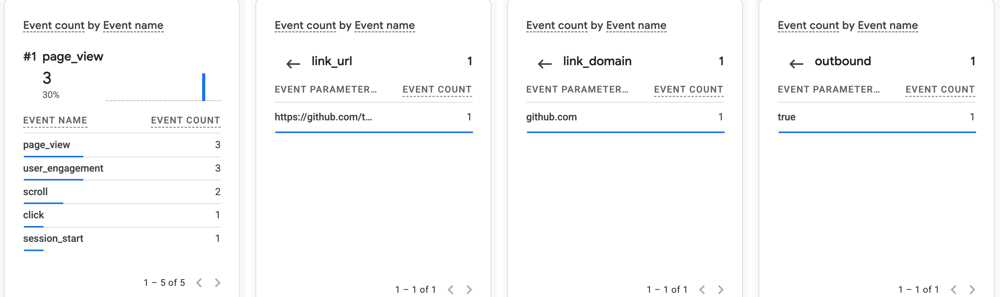

# Exercise 6 Evidence: Custom-Domain Email and Analytics

Mailbox: `tristan@tristaninfo.me` (Zoho Mail). Outside mailbox: my Gmail address, shown as `<my Gmail address>`. Message bodies are left out. Times are Pacific (PDT).

## 1. Email tests

| Test | Direction | Time | Result |
|---|---|---|---|
| Received | `<my Gmail address>` → `tristan@tristaninfo.me`, subject "Test01: inbound" | 2026-10-13 14:54 | **Pass.** Arrived in the Zoho Inbox. |
| Replied | `tristan@tristaninfo.me` → `<my Gmail address>`, "Re: Test01: inbound", sent through the Zoho MCP server | 2026-10-19 20:34 | **Pass.** Arrived in the Gmail Inbox (not Spam), threaded under the original "Test01: inbound". |
| Sent a new message | `tristan@tristaninfo.me` → `<my Gmail address>`, subject "Test 04", sent through the Zoho MCP server | 2026-10-15 14:33 | **Pass.** Arrived in the Gmail Inbox at 14:33:10 (not Spam). |

**How each test was done.** "Test01: inbound" and the before-MX message were received and read in the Zoho Mail webmail Inbox. "Test 02: Outbound" (`zoho-header-check.md`) was sent from webmail: its header shows `User-Agent: Zoho Mail`, and its first hop is `mail.zoho.com`. The reply to Test01 and "Test 04" were sent through the Zoho Mail MCP server, which uses Zoho's API on the same mailbox. **No reply was typed in the webmail UI.** The reply that was tested went through the MCP server.

### The message sent before MX existed

| Test | Direction | Time | Result |
|---|---|---|---|
| Before MX | `<my Gmail address>` → `Tristan@tristaninfo.me`, subject "Test NN: what it checks", body "est 00: before setup" | Sent 2026-10-13 14:14:16 | **Delayed, then delivered.** No bounce came back. It appeared in the Zoho Inbox at 15:15:39, 61 minutes after sending. |

The timeline, from the Gmail Sent folder, Cloudflare's record timestamps and the Zoho account details:

| PDT | What happened |
|---|---|
| 14:14:16 | Gmail sends the message. `tristaninfo.me` has no MX records yet. |
| 14:25 | The three Zoho MX records are created in Cloudflare (`dns-before-zoho.md`). |
| 14:51:00 | The `tristan@tristaninfo.me` mailbox is created in Zoho (`mailboxCreationTime`). |
| 15:15:39 | The message lands in the Zoho Inbox. |

With no MX record, a sending server falls back to the domain's own address (the "implicit MX" in RFC 5321). For `tristaninfo.me` that's Railway's web edge, which doesn't accept mail on port 25. Once the MX records existed, Zoho had no mailbox for the address until 14:51 and probably deferred the message. Either way the failures were temporary, so Gmail queued the message and retried instead of bouncing it, and a retry after the mailbox existed got through. Gmail's retry log isn't visible to the sender, so which failure each attempt hit is an inference, not something I observed.

## 2. SPF, DKIM, and DMARC results

These come from Gmail's own `Authentication-Results` header on the "Test 04" message, so they are the outside mailbox's verdict on this specific message.

| Check | Result | Domain |
|---|---|---|
| SPF | **pass** | `tristaninfo.me`, sending IP `165.173.180.52` (Zoho) |
| DKIM | **pass** | `d=tristaninfo.me`, selector `zmail` |
| DMARC | **pass** (policy `p=NONE`) | `header.from=tristaninfo.me` |

Header excerpt from Gmail (signature value cut short):

```
Authentication-Results: mx.google.com;
       dkim=pass header.i=@tristaninfo.me header.s=zmail header.b=ZWnL7Sug;
       arc=pass (i=1 spf=pass spfdomain=tristaninfo.me dkim=pass dkdomain=tristaninfo.me dmarc=pass fromdomain=tristaninfo.me>);
       spf=pass (google.com: domain of tristan@tristaninfo.me designates 165.173.180.52 as permitted sender) smtp.mailfrom=tristan@tristaninfo.me;
       dmarc=pass (p=NONE sp=NONE dis=NONE) header.from=tristaninfo.me
```

## 3. Analytics

- Live site: <https://tristaninfo.me>
- Privacy page: <https://tristaninfo.me/privacy>

GA4 Realtime, 2026-10-19 about 20:48. I allowed analytics in the consent banner, loaded the site, and clicked my GitHub link.

From left to right: the event count with `page_view` and `click`, then the `click` event's `link_url` (`https://github.com/…`), `link_domain` (`github.com`), and `outbound` (`true`). Realtime shows one parameter at a time, so these are four views joined into one image.



## 4. What MX, SPF, DKIM and DMARC do

All four are DNS records on `tristaninfo.me` (listed in `dns-before-zoho.md`). MX handles mail coming **in**. The other three let a receiving server judge mail that claims to come **from** the domain.

- **MX (mail exchanger)** tells other servers where to deliver mail for `@tristaninfo.me`: `mx.zoho.com` (priority 10) first, then `mx2` (20) and `mx3` (50) if it doesn't answer. Without MX, inbound mail has nowhere to go. That's what the before-MX message above ran into.
- **SPF (Sender Policy Framework)** is a TXT record, `v=spf1 include:zohomail.com ~all`. It lists the servers allowed to send for the domain. The receiver checks the connecting IP (Zoho's `165.173.180.52` in my tests) against it. `~all` means "soft-fail anyone else": treat it as suspicious, but don't reject outright.
- **DKIM (DomainKeys Identified Mail)**: Zoho signs every outgoing message with a private key. The matching public key is published at `zmail._domainkey.tristaninfo.me`. The receiver uses it to check that the signed headers and body weren't changed and that the signer was `d=tristaninfo.me`.
- **DMARC (Domain-based Message Authentication, Reporting and Conformance)** is a TXT record at `_dmarc.tristaninfo.me`, `v=DMARC1; p=none; rua=mailto:tristan@tristaninfo.me`. It ties the two checks to the visible From address. A message passes if SPF or DKIM passes **and** that domain matches the From domain. It also says what to do on failure: `p=none` means deliver anyway and only report, and `rua=` is where receivers send daily aggregate reports. Once the reports show only Zoho sending, the policy can move to `quarantine` or `reject`.

The "Test 04" header in section 2 shows all three passing at Gmail.

