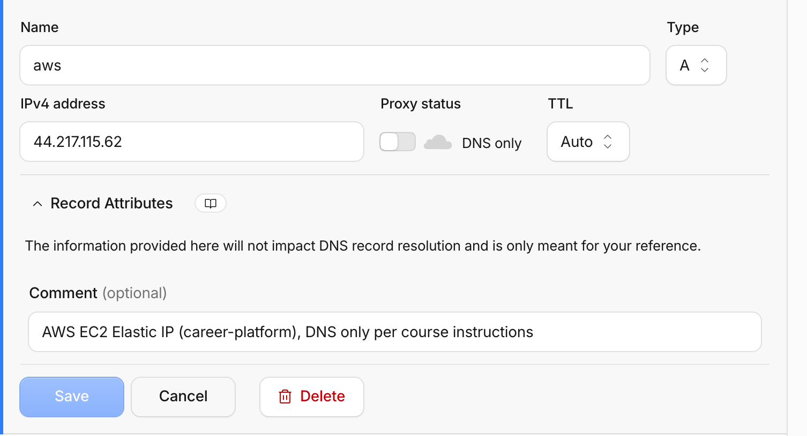
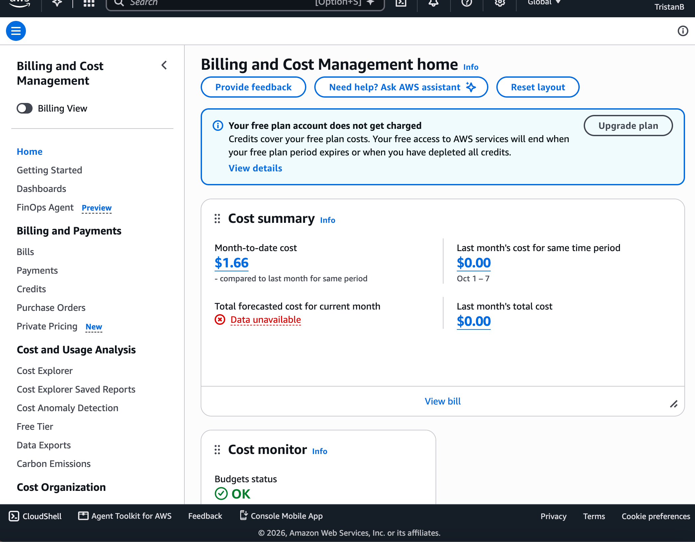

# Exercise 7 Evidence: Moving the Site to AWS

Architecture diagram: [README → Architecture → AWS](../../README.md#aws-current-since-2026-11-08). Full step-by-step record: [`migration-notes.md`](../../migration-notes.md). Times are UTC unless marked PST.

## 1. Architecture decision

I chose one EC2 instance (`t3.micro`, nginx and uvicorn) with a Single-AZ RDS PostgreSQL database over EC2 with PostgreSQL on the same instance and over Lambda with API Gateway and RDS, accepting about $26 a month of credit and running the server myself (OS updates, TLS, firewall, deploys) in exchange for a managed database and no rewrite of the app.

## 2. Backup record

| Backup | Date | Restore test | Result |
|---|---|---|---|
| `pg_dump` of the Railway database, custom format, SHA-256 recorded | 2026-10-29 22:11 | Restored into a throwaway local PostgreSQL 18 with `pg_restore --exit-on-error`, then compared row counts and a checksum of every row's contents, table by table | **Pass.** 7 tables, 18 rows, identical. The restore took 1 s |
| `pg_dump` of the Railway database at the start of the move | 2026-11-08 01:26 | This dump is what production now runs on: restored into an emptied RDS database, then compared table by table against Railway, and compared again just before DNS moved | **Pass.** `pg_restore` exit 0 in 7 s; 7 tables, 18 rows, identical both times |
| RDS automated backups (daily snapshot around 06:19, plus point-in-time recovery) | Daily since 2026-11-05; latest restorable time 2026-11-08 02:17 | Not yet tested: restoring a snapshot to a temporary database is the next step | **Not verified** |

Dumps are kept on my laptop, outside the repo. None is published here.

**What I accept:**
- **Data loss:** content only changes when I edit it with SQL, and I take a `pg_dump` before every edit, so a bad edit costs nothing older than that dump. If the database itself fails, RDS point-in-time recovery reaches back about a day, the most the AWS Free plan allows (it rejected 2 to 7 days). Anything older comes from the last dump.
- **Recovery time:** up to a day or two of downtime is acceptable, since the site is low-stakes. A database restore itself takes seconds (7 s measured); rebuilding the server from the repo's `deploy/` files is a few hours of work by my estimate (not timed).

## 3. Verification: `aws.tristaninfo.me`

Tested 2026-11-07 to 2026-11-08 from my laptop and the server.

| What I tested | Evidence | Result |
|---|---|---|
| DNS | `dig +short aws.tristaninfo.me @1.1.1.1` and `@8.8.8.8` → `44.217.115.62` (the Elastic IP); record is DNS only | **Pass** |
| HTTP redirects to HTTPS | `curl` on `/`, `/about`, `/projects?x=1`: each `301` to the `https://` URL, query string kept | **Pass** |
| Certificate | `openssl s_client`: Let's Encrypt `YE2`, subject `aws.tristaninfo.me`, valid until 2027-02-06; `curl` verify result 0; `certbot renew --dry-run` succeeded | **Pass** |
| Every page and asset | Crawled all internal links: 13 URLs (8 pages, CSS, 2 JS files, font, resume PDF), all `200` in about 0.2 to 0.4 s | **Pass** |
| Error pages | `/does-not-exist` → custom 404 page; unknown project → 404; unknown API route → JSON 404 | **Pass** |
| Reads the database | `/api/profile` → `"source": "database"`, `"degraded_mode": false` | **Pass** |
| Same content as Railway | Compared every page with the Railway site: visible text identical except `/privacy` (intended wording change); `/api/profile` byte-identical; CSS, JS, font and PDF byte-identical | **Pass** |
| Survives a reboot | `sudo systemctl reboot`: back serving from the database 22 s later, no manual steps; app, nginx and certbot timer enabled and active | **Pass** |
| Database outage | Blocked RDS on the server with `iptables` | **Failed, then fixed** (below) |
| Logs | Every logged error falls inside the outage tests (01:22 to 01:25); none since the reboot. nginx logs the visitor's real IP | **Pass** |
| Analytics consent banner | Not tried in a real browser | **Not verified** |

**The failed check:** with the database blocked while the app ran, requests hung for over 40 seconds and the whole site stopped answering, even the CSS. I retested with the connection refused outright instead: the app returned `503` straight away, as designed. So the hang was TCP waiting on silently dropped packets. Because the routes are `async` but query the database synchronously, one stuck request froze everything. I added `connect_timeout=5&tcp_user_timeout=5000` to the database URL. The rerun returned `503` on `/` and `200` on `/about`, and the site recovered without a restart. Next step: make the routes plain `def`, so a slow database can't freeze the site for the up to 12 seconds it still can.

## 4. Cutover status

**Done.** `tristaninfo.me` moved to AWS on **2026-11-08 at 01:58:47** (2026-11-07, 5:58 PM PST). The apex record changed from a CNAME to Railway to `A 44.217.115.62`, DNS only. Nothing else in the zone changed: 11 records before and after, mail records identical. The certificate was extended to `tristaninfo.me` at 01:59:28, so browsers could have shown a warning for about 40 s. Every page, the redirects, `/api/profile` and the certificate were checked live afterward. The code was merged to `main` in pull request #2 and deployed from it.

The screenshot shows the `aws` record, created first for testing. The main `tristaninfo.me` record has the same value, `A 44.217.115.62`, DNS only; `dig +short tristaninfo.me` against Cloudflare's nameserver, 1.1.1.1 and 8.8.8.8 all returned it after the change.

Still to do after the cutover: test the RDS snapshot restore, send a test email to check Zoho, and remove the app's event-loop freeze.

## 5. Cost

**Estimate:** about **$25.90 a month**, so the $120 Free plan credit lasts about 4.6 months. The rates are from memory, not current price lists, because the course user can't read AWS pricing.

| Resource | Per month |
|---|---|
| RDS `db.t4g.micro`, Single-AZ | ~$11.70 |
| RDS storage, 20 GB | ~$2.30 |
| EC2 `t3.micro` | ~$7.60 |
| EC2 disk, 8 GB gp3 | ~$0.65 |
| Public IPv4 (Elastic IP) | ~$3.65 |
| Backups (inside the free allowance) and data transfer (under 100 GB) | $0 |

**Billing page now** (Billing and Cost Management home, checked 2026-11-08): month-to-date cost **$1.66**, last month $0.00, and "Your free plan account does not get charged": credits cover it. The forecast for the month shows "Data unavailable", and the remaining credit isn't on this page. $1.66 is below what the estimate gives for RDS since 2026-11-03 and EC2 since 2026-11-07 (about $3), which fits AWS billing data lagging up to a day; I'll compare again once a full month is in.

