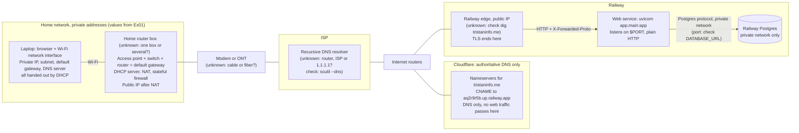
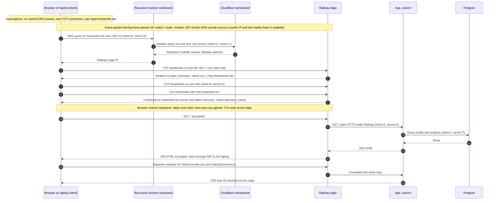
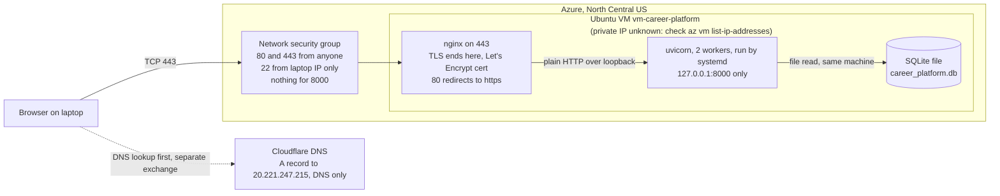

# Request Path Diagrams

What happens when a browser opens `tristaninfo.me`. Drafted with Claude Code on 2026-10-20 from the repository's plans and evidence. Anything marked **unknown** isn't recorded in the repository, and the check next to it would confirm it.

## 1. Hardware, addressing and where the services sit (Railway)

## 2. The request, step by step, with the client and server on each exchange

## 3. What changes on Azure

