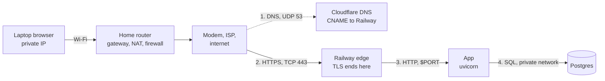
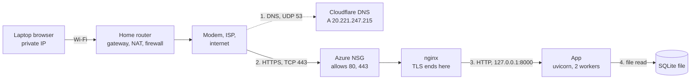

# Request Path Diagrams

What happens when a browser opens `tristaninfo.me`. Drafted with Claude Code on 2026-10-20 from the repository's plans and evidence.

Assumptions: no cached DNS answer and a new HTTPS connection. The dashed line is the DNS lookup, a separate exchange that happens first. The response comes back along the same path, and the browser then requests CSS and JS as separate requests.

## Railway (current)

## Azure (before the move)

## Not recorded in the repository

- Your private IP, gateway, and DNS resolver: check your Exercise 01 notes or `scutil --dns`.
- Whether your router, access point, and modem are one box.
- Railway's edge address and certificate: check `dig tristaninfo.me` and `openssl s_client -connect tristaninfo.me:443`.
